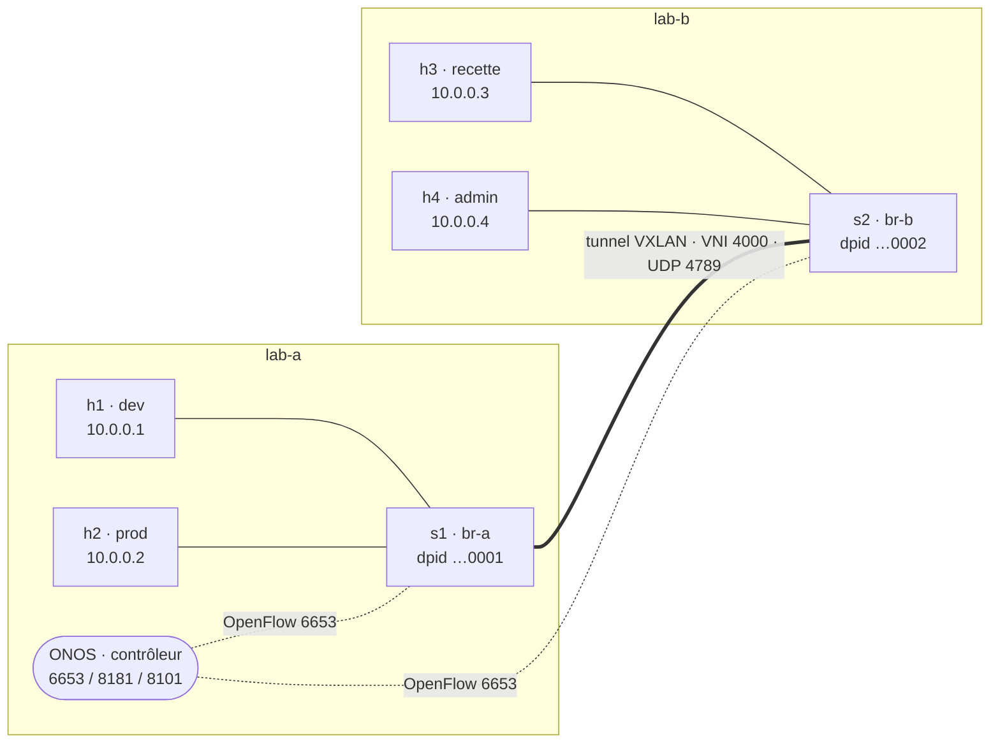

# Capstone — un réseau SDN multi-sites piloté par ONOS

**Jour 2, en fin de journée · ~1 h en autonomie (binôme conseillé).** Exercice de synthèse, **non noté**. Il recoud les deux jours : l'overlay VXLAN du module 2, le contrôleur et les intentions du module 3, et le modèle OpenFlow du module 4.

> **Repli.** Si le temps manque le jour J, la [mise en situation de 30 min](../mise-en-situation/README.md) (un switch, OpenFlow à la main) reste la version courte. Ce capstone la remplace quand on dispose d'une heure.

## Le décor

Votre binôme dispose de **deux hyperviseurs** : lab-a et lab-b. On y monte une mini-fabric à deux sites, pilotée par un **seul contrôleur ONOS** hébergé sur lab-a. Un **tunnel VXLAN** relie les deux switches ; ONOS le découvre comme un lien de fabric et gère la connectivité de bout en bout.



Les quatre zones du fil rouge deviennent quatre machines, réparties sur les deux sites : **dev** (h1) et **prod** (h2) sur lab-a, **recette** (h3) et **admin** (h4) sur lab-b. Tout le monde est dans le même segment de niveau 2 étendu par l'overlay (10.0.0.0/24) ; **c'est le contrôleur qui décide qui parle à qui**, pas un VLAN.

## Prérequis réseau entre lab-a et lab-b

- **TCP 6653** ouvert de lab-b vers lab-a (le switch s2 ouvre sa session OpenFlow vers l'ONOS de lab-a).
- **UDP 4789** ouvert dans les deux sens (le tunnel VXLAN) — déjà éprouvé au TP2-B.
- MTU : les machines sont fixées à 1450 pour absorber l'encapsulation.

Lancez ONOS sur lab-a (étape 1), puis depuis lab-b : `sudo bash verif_prevol.sh <IP_LAB_A>` doit afficher tout en `[ OK ]`.

## Étape 1 — Monter l'infrastructure (fourni)

Relevez les IP LAN des deux machines (`ip -br a`). On note `A` = IP de lab-a, `B` = IP de lab-b. Les scripts d'infrastructure sont fournis ; votre travail commence à l'étape 2.

```bash
# sur lab-a
sudo bash infra_lab_a.sh A B      # ONOS + s1 + h1 (dev) + h2 (prod) + tunnel

# sur lab-b
sudo bash infra_lab_b.sh A B      # s2 + h3 (recette) + h4 (admin) + tunnel
```

**Vérifier que le contrôleur voit bien les deux sites**, depuis lab-a :

```bash
curl -s -u onos:rocks http://localhost:8181/onos/v1/devices | jq -r '.devices[].id'   # 2 switches : ...0001 et ...0002
curl -s -u onos:rocks http://localhost:8181/onos/v1/links   | jq '.links | length'     # >= 2 (le lien s1<->s2, dans les deux sens)
curl -s -u onos:rocks http://localhost:8181/onos/v1/hosts   | jq '.hosts | length'     # 4 une fois les machines actives (voir ci-dessous)
```

Si les hôtes n'apparaissent pas encore, c'est normal : ONOS les découvre à leur premier paquet. Lancez un ping (il échouera tant que la politique n'est pas posée, mais il révèle les hôtes au contrôleur).

## Étape 2 — La mission : décrire la politique, ONOS l'applique

L'infrastructure est prête mais **ouverte** (l'application `fwd` achemine tout). Votre mission : passer à un modèle **« tout ce qui n'est pas autorisé est interdit »** et n'ouvrir que les communications prévues par la politique des zones.

**La politique à obtenir :**

| de \ vers | dev (h1) | prod (h2) | recette (h3) | admin (h4) |
| --- | --- | --- | --- | --- |
| **dev** (h1) | — | autorisé | **interdit** | autorisé |
| **prod** (h2) | autorisé | — | autorisé | autorisé |
| **recette** (h3) | **interdit** | autorisé | — | autorisé |
| **admin** (h4) | autorisé | autorisé | autorisé | — |

Autrement dit : l'admin supervise tout le monde, le dev déploie en prod, la recette teste la prod, mais **dev et recette ne se parlent pas** — et rien ne passe entre les deux sites sans que le contrôleur l'ait décidé.

**Votre travail :**

1. Passer en **défaut-refus** : couper l'acheminement automatique (`fwd`).
2. Déclarer la connectivité autorisée **par des intentions** (comme au TP3-B/3-C, mais ici à travers le tunnel, entre deux hyperviseurs). Écrivez-les dans un script rejouable qui appelle l'API REST d'ONOS — la politique comme du code.
3. **Prouver** le résultat : la matrice de connectivité est exactement celle ci-dessus ; une capture du tunnel (`tcpdump udp port 4789`) montre le trafic inter-sites encapsulé ; la topologie d'ONOS montre bien deux sites et un lien.

Les machines étant des namespaces, testez une case de la matrice ainsi :

```bash
sudo ip netns exec h1 ping -c1 -W1 10.0.0.2    # dev -> prod (sur lab-a)
sudo ip netns exec h3 ping -c1 -W1 10.0.0.1    # recette -> dev (sur lab-b) : doit échouer
```

## Livrables

- `politique_multisite.sh` : le script qui déclare les intentions par l'API REST, commité.
- La capture annotée du tunnel (VNI 4000, UDP 4789) prouvant le trafic inter-sites.
- La matrice de connectivité obtenue (sortie de vos tests).

## Pour aller plus loin

- **Filtrage L4 fin** : n'autoriser recette → prod qu'en TCP 443 (au lieu de tout) — par une `PointToPointIntent` avec un sélecteur `tcp dst 443`, ou l'application ACL d'ONOS.
- **Copie vers une sonde** : dupliquer le trafic destiné à prod vers l'admin (sonde) — plus délicat sur un switch piloté ; à traiter par une règle de flux posée via l'API d'ONOS.
- **Résilience** : ajouter un second tunnel (autre chemin d'underlay) et couper le premier pour voir ONOS recalculer — c'est ce qui manque avec un lien unique.
- **Multi-locataire** : un second segment (VNI 4001) isolé du premier.

---

> ⚠️ **À éprouver en amont, comme le reste du lab.** Trois points à valider sur une vraie paire lab-a/lab-b avant la session : (1) ONOS découvre bien le lien s1↔s2 **à travers le tunnel VXLAN** (LLDP encapsulé) ; (2) une fois `fwd` coupé, seules les paires déclarées par intentions se joignent (défaut-refus) ; (3) l'ARP fonctionne entre sites grâce à `proxyarp`. Le [corrigé](corrige/README.md) donne la solution de référence et les commandes de preuve.
