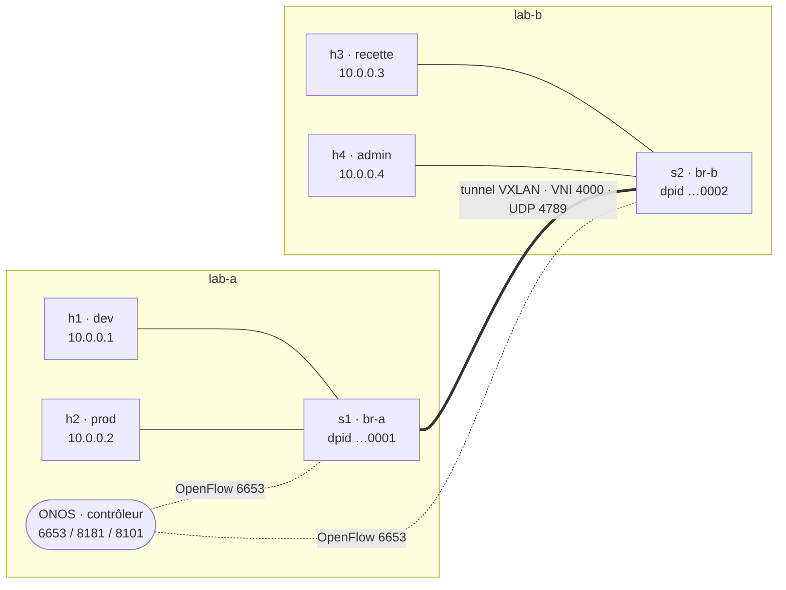

# Projet final — un réseau SDN multi-sites piloté par ONOS

**Jour 2, en fin de journée · ~1 h, en binôme, en autonomie.** Projet de synthèse, **non noté**. À vous de **tout monter vous-mêmes**, à partir de ce que vous avez appris sur les deux jours : l'overlay VXLAN (TP2-B), le contrôleur et les intentions (TP3), le modèle OpenFlow (TP4). **Aucun script n'est fourni** — vous écrivez les vôtres. Seule exception : un script de remise à zéro, [`reset.sh`](reset.sh).

## L'objectif

Deux hyperviseurs, **lab-a** et **lab-b**, forment une mini-fabric à deux sites, pilotée par un **seul contrôleur ONOS** hébergé sur lab-a. Un **tunnel VXLAN** relie les deux switches ; ONOS le découvre comme un lien de fabric et gère la connectivité de bout en bout. Puis vous appliquez une **politique** : qui parle à qui.



## Ce que vous devez construire

Relevez d'abord les IP LAN des deux machines (`ip -br a`). Puis montez l'infrastructure suivante. Chaque brique, vous l'avez déjà faite dans un TP — ici vous les assemblez.

**Le contrôleur, sur lab-a** : ONOS 2.7.0 dans Docker (comme au TP3-A), avec les applications `openflow`, `fwd`, `proxyarp`, `gui2`, et ses ports 6653 / 8181 / 8101 publiés.

**Les deux switches**, en OpenFlow 1.3, fail-mode `secure`, pilotés par cet ONOS :

| Switch | Hôte | Nom du pont | dpid | Contrôleur |
| --- | --- | --- | --- | --- |
| s1 | lab-a | `br-a` | `0000000000000001` | `tcp:127.0.0.1:6653` |
| s2 | lab-b | `br-b` | `0000000000000002` | `tcp:<IP_LAB_A>:6653` |

**Le lien inter-sites** : un **tunnel VXLAN**, VNI `4000`, entre `br-a` et `br-b`, avec `local_ip` / `remote_ip` = les deux adresses LAN (comme au TP2-B, mais ici le tunnel relie deux switches, pas deux hôtes).

**Les quatre machines** (des namespaces), toutes dans `10.0.0.0/24`, **MTU 1450** (pour la marge d'encapsulation) :

| Machine | Zone | Hôte | Adresse | MAC |
| --- | --- | --- | --- | --- |
| h1 | dev | lab-a | 10.0.0.1/24 | 00:00:00:00:00:01 |
| h2 | prod | lab-a | 10.0.0.2/24 | 00:00:00:00:00:02 |
| h3 | recette | lab-b | 10.0.0.3/24 | 00:00:00:00:00:03 |
| h4 | admin | lab-b | 10.0.0.4/24 | 00:00:00:00:00:04 |

**Vérifiez que le contrôleur voit bien les deux sites**, depuis lab-a :

```bash
curl -s -u onos:rocks http://localhost:8181/onos/v1/devices | jq -r '.devices[].id'   # 2 switches
curl -s -u onos:rocks http://localhost:8181/onos/v1/links   | jq '.links | length'     # >= 2 (lien s1<->s2)
curl -s -u onos:rocks http://localhost:8181/onos/v1/hosts   | jq '.hosts | length'     # 4 (après un premier ping)
```

Les hôtes n'apparaissent qu'à leur premier paquet : un ping, même échoué, les révèle au contrôleur.

## La politique à appliquer

L'infrastructure est prête mais **ouverte** (`fwd` achemine tout). Faites passer le réseau en **« tout ce qui n'est pas autorisé est interdit »**, et n'ouvrez que les communications prévues :

| de \ vers | dev (h1) | prod (h2) | recette (h3) | admin (h4) |
| --- | --- | --- | --- | --- |
| **dev** (h1) | — | autorisé | **interdit** | autorisé |
| **prod** (h2) | autorisé | — | autorisé | autorisé |
| **recette** (h3) | **interdit** | autorisé | — | autorisé |
| **admin** (h4) | autorisé | autorisé | autorisé | — |

L'admin supervise tout le monde ; le dev déploie en prod ; la recette teste la prod ; **dev et recette ne se parlent pas**. La politique s'applique **par le contrôleur** (comme au TP3-B/3-C), pas en `ovs-ofctl` à la main — un switch piloté par ONOS se programme par ONOS. Démarche attendue : couper `fwd` (défaut-refus), puis déclarer la connectivité autorisée par des **intentions**, dans un script rejouable qui appelle l'API REST.

Testez une case ainsi :

```bash
sudo ip netns exec h1 ping -c1 -W1 10.0.0.2    # dev -> prod (sur lab-a) : doit passer
sudo ip netns exec h3 ping -c1 -W1 10.0.0.1    # recette -> dev (sur lab-b) : doit échouer
```

## Livrables

- **Vos scripts** : le montage de l'infra (lab-a et lab-b) et la politique, rejouables et commités.
- **La matrice de connectivité** obtenue (la sortie de vos tests), conforme au tableau.
- **Une capture du tunnel** (`tcpdump udp port 4789`) prouvant que le trafic inter-sites est bien encapsulé en VXLAN.

## Remise à zéro

Un script est fourni pour repartir propre, à lancer sur **chaque** machine :

```bash
sudo bash reset.sh
```

## Prérequis réseau (déjà validés pour votre infra)

- **TCP 6653** ouvert de lab-b vers lab-a (session OpenFlow de s2 vers ONOS).
- **UDP 4789** ouvert dans les deux sens (le tunnel VXLAN), déjà éprouvé au TP2-B.
