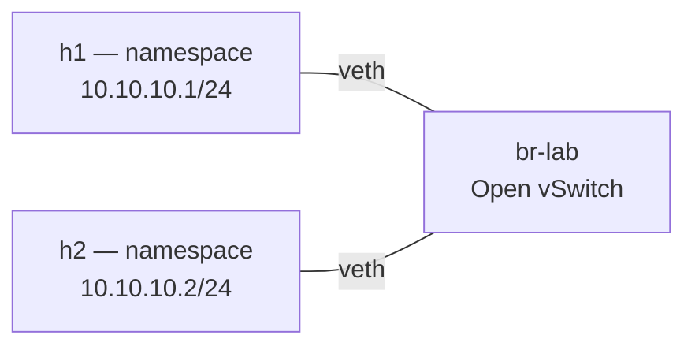

# TP1-A — Un réseau virtuel en dix commandes

**Jour 1, 09:40 · 45 min.** Objectif : construire un réseau virtuel isolé sur un hôte Linux, en une dizaine de commandes. Support : chapitres 3 et 4.

## Installation des outils (une seule fois, pour les deux jours)

Votre machine lab-a est un Ubuntu 24.04 vierge : le bureau et Firefox, mais aucun outil réseau. On les installe maintenant :

```bash
sudo apt-get update && sudo apt-get install -y git
git clone https://github.com/tahero-madi/virtualisation-reseau-sdn.git ~/lab
cd ~/lab
sudo bash infra/preparation_vm.sh --kit "$PWD" --sans-bureau
```

On se place dans `~/lab` puis on lance avec un chemin relatif : sous `sudo`, un `~` pointerait vers `/root`, pas vers votre dossier. Le script installe tout le lab, en quelques minutes :

- **Open vSwitch** et **Mininet** — les commutateurs virtuels et les topologies ;
- **Docker** et l'image du contrôleur **ONOS 2.7.0**, utilisée au jour 2 ;
- un environnement Python **os-ken** dans `~/osken`, pour le jour 2 ;
- les outils d'observation : **nftables**, **tcpdump**, **tshark**, **iperf**, **jq**, **git**.

À la fin, le script affiche `Installation terminée : tout est prêt`, après une série de contrôles. Prenez alors un **instantané « outils installés »** : en cas de pépin pendant un TP, vous y reviendrez plutôt qu'à la machine vierge.

## L'exercice

Relier deux machines isolées, h1 et h2 (zone dev), par un commutateur Open vSwitch, puis observer ce que fait le commutateur. On construit **h1 ensemble**, puis **vous reproduisez h2** par vous-mêmes. Voici l'infrastructure visée :



### Étape 1 — Le commutateur virtuel

```bash
sudo ovs-vsctl add-br br-lab
sudo ovs-vsctl show     # le commutateur br-lab et ses ports (aucun pour l'instant)
```

**Ligne par ligne.**

- `ovs-vsctl add-br br-lab` : crée le commutateur virtuel Open vSwitch « br-lab », vide pour l'instant.
- `ovs-vsctl show` : affiche la configuration du commutateur lue dans la base OVSDB — son pont `br-lab` et ses ports (encore aucun).

### Étape 2 — Construire h1 (guidé)

```bash
sudo ip netns add h1
sudo ip link add h1-eth0 type veth peer name h1-port
sudo ip link set h1-eth0 netns h1
sudo ovs-vsctl add-port br-lab h1-port
sudo ip link set h1-port up
sudo ip -n h1 link set lo up
sudo ip -n h1 link set h1-eth0 up
sudo ip -n h1 addr add 10.10.10.1/24 dev h1-eth0
```

**Ligne par ligne.**

- `ip netns add h1` : crée « h1 », une machine isolée. Un *network namespace* est une pile réseau complète et séparée (interfaces, routes, cache ARP) dans le même noyau.
- `ip link add h1-eth0 type veth peer name h1-port` : crée un câble virtuel à deux bouts — `h1-eth0` (côté machine) et `h1-port` (côté commutateur).
- `ip link set h1-eth0 netns h1` : pousse le bout `h1-eth0` dans la machine ; c'est sa carte réseau.
- `ovs-vsctl add-port br-lab h1-port` : branche l'autre bout sur le commutateur.
- `ip link set h1-port up` : active le port côté commutateur.
- `ip -n h1 link set lo up` : active la boucle locale (`lo`) dans la machine — souvent oubliée.
- `ip -n h1 link set h1-eth0 up` : active la carte réseau dans la machine.
- `ip -n h1 addr add 10.10.10.1/24 dev h1-eth0` : attribue son adresse IP à h1 (zone dev).

**Vérifier h1 :**

```bash
ip -br link show h1-port     # le port côté commutateur (hôte) : doit être UP
sudo ip -n h1 -br addr       # dans h1 : lo, et h1-eth0 qui porte 10.10.10.1/24
```

- `ip -br link show h1-port` : état bref (`-br`) du port côté hôte ; il doit être `UP`.
- `ip -n h1 -br addr` : `-n h1` exécute la commande *dans* le namespace h1 ; vous n'y voyez que ses propres interfaces, preuve de l'isolement.

### Étape 3 — À vous : construire h2

Reproduisez **exactement les mêmes gestes pour h2** : le namespace `h2`, le câble `h2-eth0`/`h2-port`, le branchement sur `br-lab`, l'activation des interfaces, et l'adresse **10.10.10.2/24**. Puis vérifiez que les deux machines se joignent :

```bash
sudo ip netns list                            # doit lister h1 ET h2
sudo ip netns exec h1 ping -c 2 10.10.10.2    # si h2 est bien construite : 0% packet loss
```

- `ip netns list` : vous devez maintenant voir `h1` et `h2`.
- `ip netns exec h1 ping -c 2 10.10.10.2` : depuis h1, 2 paquets vers h2 ; le ping ne passe **que si** h2 est correctement câblée, activée et adressée. C'est votre vérification.

> Bloqué ? Les commandes de h2 sont dans le [corrigé](corrige/README.md).

### Observer ce que fait le commutateur

```bash
sudo ovs-vsctl show                 # ses ponts et ses ports (h1-port, h2-port)
sudo ovs-ofctl dump-flows br-lab    # ses règles OpenFlow : ici une seule, NORMAL
sudo ovs-appctl fdb/show br-lab     # sa table d'apprentissage : quelle MAC sur quel port
sudo ip netns exec h1 ip neigh      # la table ARP de h1 : les voisins (IP ↔ MAC) vus
```

- `ovs-vsctl show` : la configuration du commutateur ; vous y voyez maintenant `h1-port` et `h2-port`.
- `ovs-ofctl dump-flows br-lab` : les règles OpenFlow ; par défaut une seule, `actions=NORMAL`, qui le fait commuter comme un switch classique.
- `ovs-appctl fdb/show br-lab` : la table d'apprentissage des adresses MAC (quelle MAC derrière quel port).
- `ip netns exec h1 ip neigh` : le cache ARP de h1 (les correspondances IP ↔ MAC apprises).

Questions :

1. Pourquoi `ip a` exécuté dans h1 ne montre-t-il pas les interfaces de l'hôte ?
2. Que signifie l'action `NORMAL` affichée par `dump-flows` ?
3. Retirez `h2-port` du bridge (`ovs-vsctl del-port`), relancez le ping, puis rebranchez. Que montre `fdb/show` avant et après ?

**Bonus : un conteneur est un namespace comme les autres.**

```bash
sudo docker run -d --name web alpine:3.20 sleep 3600
PID=$(sudo docker inspect -f '{{.State.Pid}}' web)
sudo nsenter -t "$PID" -n ip addr
bridge link | grep docker0
sudo docker rm -f web
```

**Ligne par ligne.**

- `docker run -d --name web alpine:3.20 sleep 3600` : lance un conteneur qui tourne en fond.
- `PID=$(sudo docker inspect -f '{{.State.Pid}}' web)` : récupère le PID du conteneur sur l'hôte.
- `nsenter -t "$PID" -n ip addr` : entre dans le namespace réseau du conteneur et liste ses interfaces — c'est exactement un namespace comme h1.
- `bridge link | grep docker0` : montre le câble veth du conteneur, branché sur le pont `docker0`.
- `docker rm -f web` : supprime le conteneur.

Livrable : `tp1a.sh` rejouable, commité.
