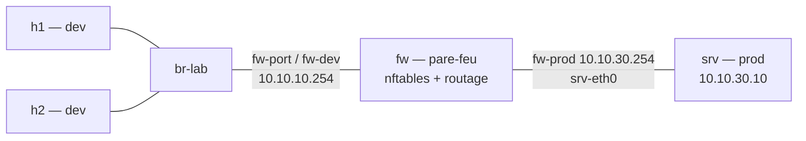

# TP1-B — Un pare-feu virtualisé

**Jour 1, 10:35 · 30 min.** Objectif : insérer un pare-feu logiciel — une VNF — qu'on détruit et recrée par script. Support : chapitres 3 et 4.

Insérer un pare-feu, la « VNF » `fw`, entre la zone dev (h1, h2) et un serveur de la zone prod (`srv`, 10.10.30.10). On repart du réseau du TP1-A (h1, h2 sur `br-lab`) :



### Étape 1 — Instancier la VNF (le pare-feu) et le serveur de prod

```bash
sudo ip netns add fw
sudo ip netns add srv
sudo ip link add fw-dev type veth peer name fw-port
sudo ip link set fw-dev netns fw
sudo ovs-vsctl add-port br-lab fw-port && sudo ip link set fw-port up
sudo ip link add fw-prod type veth peer name srv-eth0
sudo ip link set fw-prod netns fw
sudo ip link set srv-eth0 netns srv

sudo ip -n fw addr add 10.10.10.254/24 dev fw-dev
sudo ip -n fw addr add 10.10.30.254/24 dev fw-prod
sudo ip -n srv addr add 10.10.30.10/24 dev srv-eth0
for i in lo fw-dev fw-prod; do sudo ip -n fw link set $i up; done
for i in lo srv-eth0; do sudo ip -n srv link set $i up; done
sudo ip netns exec fw sysctl -w net.ipv4.ip_forward=1
sudo ip -n h1 route add default via 10.10.10.254
sudo ip -n h2 route add default via 10.10.10.254
sudo ip -n srv route add default via 10.10.30.254
```

**Ligne par ligne.**

- `ip netns add fw` / `ip netns add srv` : créent le pare-feu et le serveur de production, deux machines isolées.
- `ip link add fw-dev type veth peer name fw-port` : câble entre le pare-feu et le commutateur, côté dev.
- `ip link set fw-dev netns fw` : pousse le bout `fw-dev` dans le pare-feu.
- `ovs-vsctl add-port br-lab fw-port && ip link set fw-port up` : branche l'autre bout sur `br-lab` et l'active.
- `ip link add fw-prod type veth peer name srv-eth0` : câble direct entre le pare-feu et le serveur, côté prod (sans passer par le commutateur).
- `ip link set fw-prod netns fw` / `ip link set srv-eth0 netns srv` : chaque bout dans sa machine.
- `ip -n fw addr add 10.10.10.254/24 dev fw-dev` : patte du pare-feu côté dev = passerelle de la zone dev.
- `ip -n fw addr add 10.10.30.254/24 dev fw-prod` : patte côté prod = passerelle de la zone prod.
- `ip -n srv addr add 10.10.30.10/24 dev srv-eth0` : adresse du serveur.
- les deux boucles `for i in … ip link set $i up` : activent les interfaces du pare-feu puis du serveur (sans oublier `lo`).
- `ip netns exec fw sysctl -w net.ipv4.ip_forward=1` : autorise le pare-feu à **router** entre ses deux pattes.
- `ip -n h1 route add default via 10.10.10.254` / `h2` : h1 et h2 sortent par le pare-feu.
- `ip -n srv route add default via 10.10.30.254` : le serveur répond en repassant par le pare-feu.

### Étape 2 — Appliquer la politique de filtrage

```bash
sudo ip netns exec fw nft -f - <<'EOF'
table inet vnf {
  chain forward {
    type filter hook forward priority 0; policy drop;
    ct state established,related accept
    ip saddr 10.10.10.1 ip daddr 10.10.30.10 tcp dport 80 accept
    ip saddr 10.10.10.0/24 ip daddr 10.10.30.10 icmp type echo-request accept
  }
}
EOF
```

**Ligne par ligne** (règles nftables chargées dans le pare-feu) :

- `type filter hook forward priority 0; policy drop;` : par défaut, **jeter** tout ce qui traverse le pare-feu.
- `ct state established,related accept` : laisser revenir les réponses des connexions déjà acceptées (suivi de connexions).
- `ip saddr 10.10.10.1 … tcp dport 80 accept` : h1 → serveur en HTTP (port 80) autorisé.
- `ip saddr 10.10.10.0/24 … icmp type echo-request accept` : toute la zone dev → serveur en ping autorisé.

### Étape 3 — Tester

```bash
sudo ip netns exec srv python3 -m http.server 80 &
sudo ip netns exec h1 curl -s -m 3 -o /dev/null -w '%{http_code}\n' http://10.10.30.10/   # 200
sudo ip netns exec h2 curl -s -m 3 -o /dev/null -w '%{http_code}\n' http://10.10.30.10/   # 000
sudo ip netns exec h2 ping -c 2 10.10.30.10                                                # autorisé
sudo ip netns exec fw nft list ruleset > vnf-fw.nft
```

**Ligne par ligne.**

- `ip netns exec srv python3 -m http.server 80 &` : lance un serveur web de test dans `srv`, en fond.
- `curl … depuis h1` : h1 → serveur en HTTP, doit répondre **200**.
- `curl … depuis h2` : h2 → serveur en HTTP, bloqué par la politique, code **000**.
- `ping -c 2` depuis h2 : h2 → serveur en ping, **autorisé**.
- `nft list ruleset > vnf-fw.nft` : sauvegarde la configuration du pare-feu (livrable).

| Test | Résultat attendu |
| --- | --- |
| h1 vers le serveur en HTTP | Code 200 |
| h2 vers le serveur en HTTP | Code 000 (bloqué) |
| h2 vers le serveur en ping | Réponses reçues |

### Étape 4 — Le geste NFV : détruire et recréer

Rassemblez les commandes des étapes 1 à 3 dans `tp1b.sh`. Pour pouvoir le **rejouer**, il faut d'abord remettre l'environnement à zéro : supprimer le namespace `fw` ne suffit pas, car son port côté commutateur, les interfaces restées sur l'hôte après un essai interrompu et les routes par défaut de h1 et h2 doivent aussi être nettoyés. On fournit pour cela le script `infra-delete.sh` :

```bash
#!/usr/bin/env bash
set -euo pipefail

ovs-vsctl --if-exists del-port br-lab fw-port            # retire le port resté côté commutateur

for ns in fw srv; do                                     # arrête les processus puis supprime fw et srv
    if ip -n "$ns" link show >/dev/null 2>&1; then
        ip netns pids "$ns" | xargs -r kill
        ip netns del "$ns"
    fi
done

for iface in fw-port fw-dev fw-prod srv-eth0; do         # nettoie les interfaces restées sur l'hôte
    if ip link show dev "$iface" >/dev/null 2>&1; then
        ip link del dev "$iface"
    fi
done

ip -n h1 -4 route flush exact default                    # retire la route par défaut de h1
ip -n h2 -4 route flush exact default                    # et de h2
```

On détruit, puis on recrée tout par script en chronométrant :

```bash
sudo bash infra-delete.sh    # remet l'environnement à zéro (pare-feu, serveur, ports, routes)
time sudo bash tp1b.sh       # recrée toute la VNF par script, et chronomètre l'opération
```

**Ligne par ligne.**

- `sudo bash infra-delete.sh` : détruit proprement la VNF et nettoie tout ce qu'elle avait créé, pour que `tp1b.sh` puisse être relancé sans erreur « File exists ».
- `time sudo bash tp1b.sh` : recrée l'intégralité du pare-feu et du serveur par script ; `time` affiche le temps — quelques secondes pour une fonction réseau complète.

Questions :

1. Pourquoi la règle `ct state established,related accept` est-elle indispensable ?
2. Où se trouve « physiquement » ce pare-feu ? Qu'est-ce que cela change pour la sauvegarde, le plan de reprise et la montée en charge ?
3. Qu'apporterait un orchestrateur (MANO, Kubernetes) à ce que vous venez de faire à la main ?
4. Quelles fonctions de votre périmètre pourraient devenir des VNF ou des CNF ?

Livrables : `tp1b.sh`, `infra-delete.sh` et `vnf-fw.nft`, commités.
