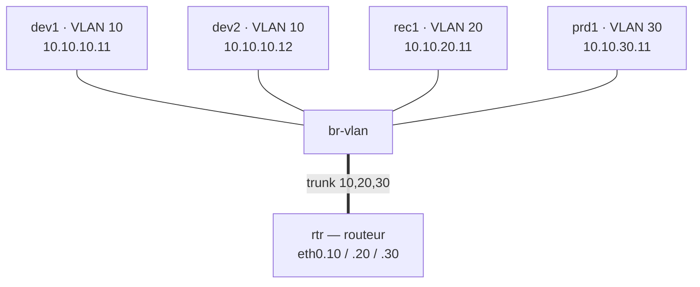

# TP2-A — VLAN, routage et filtrage entre zones

**Jour 1, 13:30 · 65 min.** Objectif : isoler les zones par VLAN et les relier par un routeur qui filtre. Support : chapitres 5 à 8. Commencez par `sudo bash reset_lab.sh`.

Plutôt que de tout générer par un script, vous allez construire l'infrastructure vous-mêmes : on fait ensemble la première machine et le premier VLAN, puis **vous créez le reste** à partir des informations ci-dessous, et un script vérifie votre travail.



Les quatre machines à créer, avec la **convention de nommage** (reprise de TP1) : machine `X` → namespace `X`, interface `X-eth0` (côté machine), port `X-port` (côté commutateur) :

| Machine | VLAN | Adresse | Passerelle |
| --- | --- | --- | --- |
| dev1 | 10 | 10.10.10.11/24 | 10.10.10.254 |
| dev2 | 10 | 10.10.10.12/24 | 10.10.10.254 |
| rec1 | 20 | 10.10.20.11/24 | 10.10.20.254 |
| prd1 | 30 | 10.10.30.11/24 | 10.10.30.254 |

### Étape 1 — Le commutateur et la première machine (guidé)

```bash
sudo ovs-vsctl --may-exist add-br br-vlan
sudo ip netns add dev1
sudo ip link add dev1-eth0 type veth peer name dev1-port
sudo ip link set dev1-eth0 netns dev1
sudo ovs-vsctl add-port br-vlan dev1-port tag=10
sudo ip link set dev1-port up
sudo ip -n dev1 addr add 10.10.10.11/24 dev dev1-eth0
sudo ip -n dev1 link set dev1-eth0 up
sudo ip -n dev1 link set lo up
sudo ip -n dev1 route add default via 10.10.10.254
```

**Ligne par ligne.**

- `ovs-vsctl --may-exist add-br br-vlan` : crée le commutateur `br-vlan` (sans erreur s'il existe déjà).
- `ip netns add dev1` : crée la machine dev1.
- `ip link add dev1-eth0 type veth peer name dev1-port` : son câble à deux bouts.
- `ip link set dev1-eth0 netns dev1` : le bout `-eth0` dans la machine.
- `ovs-vsctl add-port br-vlan dev1-port tag=10` : l'autre bout sur le commutateur, en **port d'accès** du VLAN 10 (`tag`).
- `ip link set dev1-port up` : active le port côté commutateur.
- `ip -n dev1 addr add 10.10.10.11/24 dev dev1-eth0` : son adresse IP.
- les deux `link set … up` : activent `dev1-eth0` et `lo` dans la machine.
- `ip -n dev1 route add default via 10.10.10.254` : sa passerelle = le routeur (créé plus bas).

### Étape 2 — À vous : les trois autres machines

Créez **dev2, rec1 et prd1** sur le même modèle que dev1, en reprenant le VLAN, l'adresse et la passerelle du tableau. Puis vérifiez :

```bash
sudo bash verif_hosts.sh
```

Le script contrôle, pour chaque machine, que son namespace existe, que `X-eth0` porte la bonne adresse, et que `X-port` est en accès sur le bon VLAN. Corrigez tant qu'il reste des `[ECHEC]`.

**Vérifier l'isolement** une fois les quatre machines créées :

```bash
sudo ip netns exec dev1 ping -c 2 10.10.10.12   # dev1 -> dev2 (même VLAN) : passe
sudo ip netns exec dev1 ping -c 2 10.10.20.11   # dev1 -> rec1 (autre VLAN) : échoue
```

- Premier ping : dev1 et dev2 sont dans le même VLAN 10, la communication passe.
- Second ping : rec1 est dans le VLAN 20, un autre segment ; sans routeur, rien ne passe. **Les VLAN isolent.**

### Étape 3 — Le routeur (router on a stick)

On crée le routeur et on active le routage **avant** d'ajouter les sous-interfaces, puis on fait ensemble la sous-interface du VLAN 10 :

```bash
sudo ip netns add rtr
sudo ip link add rtr-eth0 type veth peer name rtr-port
sudo ip link set rtr-eth0 netns rtr
sudo ovs-vsctl add-port br-vlan rtr-port trunks=10,20,30
sudo ip link set rtr-port up
sudo ip -n rtr link set rtr-eth0 up
sudo ip netns exec rtr sysctl -w net.ipv4.ip_forward=1

# sous-interface du VLAN 10 (on la fait ensemble)
sudo ip -n rtr link add link rtr-eth0 name rtr-eth0.10 type vlan id 10
sudo ip -n rtr addr add 10.10.10.254/24 dev rtr-eth0.10
sudo ip -n rtr link set rtr-eth0.10 up
```

**Ligne par ligne.**

- `ip netns add rtr` : crée le routeur, à cheval sur les trois VLAN.
- `ip link add rtr-eth0 type veth peer name rtr-port` : son câble.
- `ovs-vsctl add-port br-vlan rtr-port trunks=10,20,30` : port **trunk** — il transporte les VLAN 10, 20 et 30 **étiquetés** (et non en accès).
- `ip netns exec rtr sysctl -w net.ipv4.ip_forward=1` : active le **routage** entre les VLAN (fait avant les sous-interfaces).
- `ip -n rtr link add link rtr-eth0 name rtr-eth0.10 type vlan id 10` : crée une sous-interface qui ne voit que le VLAN 10.
- `ip -n rtr addr add 10.10.10.254/24 dev rtr-eth0.10` : la passerelle de la zone dev.

**À vous :** créez de la même façon `rtr-eth0.20` (10.10.20.254) et `rtr-eth0.30` (10.10.30.254), puis vérifiez :

```bash
sudo bash verif_routeur.sh
```

Le script contrôle que le routage est actif, que `rtr-port` est en trunk, et qu'il existe une sous-interface avec sa passerelle pour chacun des trois VLAN.

### Étape 4 — Lire la norme dans le paquet

```bash
sudo ip netns exec dev1 ping -c 20 10.10.30.11 > /dev/null &
sudo tcpdump -e -n -i rtr-port -c 4 icmp
```

**Ligne par ligne.**

- `ping -c 20 … > /dev/null &` : génère du trafic dev → prod en fond.
- `tcpdump -e -n -i rtr-port -c 4 icmp` : capture sur le trunk ; l'option `-e` affiche l'en-tête Ethernet, donc l'**étiquette VLAN 802.1Q** (`vlan 10`, EtherType `0x8100`).

### Étape 5 — Appliquer une politique entre zones

```bash
sudo ip netns exec rtr nft -f - <<'EOF'
table inet zones {
  chain forward {
    type filter hook forward priority 0; policy drop;
    ct state established,related accept
    iifname "rtr-eth0.10" oifname "rtr-eth0.20" accept
    iifname "rtr-eth0.20" oifname "rtr-eth0.30" tcp dport 443 accept
    iifname "rtr-eth0.20" oifname "rtr-eth0.30" icmp type echo-request accept
  }
}
EOF
```

**Ligne par ligne** (règles chargées dans le routeur) :

- `policy drop` : par défaut, aucune zone ne parle à une autre.
- `ct state established,related accept` : laisser revenir les réponses des connexions acceptées.
- `iifname "rtr-eth0.10" oifname "rtr-eth0.20" accept` : dev → recette, tout autorisé.
- `… rtr-eth0.20 … rtr-eth0.30 tcp dport 443 accept` : recette → prod, seulement en HTTPS (443).
- `… icmp type echo-request accept` : recette → prod, ping autorisé.

| Test | Résultat attendu |
| --- | --- |
| dev1 → rec1 (ping) | Autorisé |
| dev1 → prd1 (ping) | Bloqué |
| rec1 → prd1 (ping) | Autorisé |
| prd1 → dev1 (ping) | Bloqué |

### Étape 6 — Où vit la configuration

```bash
sudo ovsdb-client list-tables
sudo ovs-vsctl --columns=name,tag,trunks list Port
sudo ovsdb-client monitor Open_vSwitch Port name tag   # s'abonne aux changements ; dans un 2e terminal, ajoutez un port
```

**Ligne par ligne.**

- `ovsdb-client list-tables` : liste les tables de la base de configuration d'Open vSwitch (OVSDB, RFC 7047). Toute la configuration que montre `ovs-vsctl show` est rangée dans ces tables ; les principales :

| Table | Contenu |
| --- | --- |
| `Open_vSwitch` | la racine de la configuration |
| `Bridge` | les ponts, comme `br-vlan` |
| `Port` | les ports, avec leur VLAN d'accès (`tag`) ou de trunk (`trunks`) |
| `Interface` | les interfaces (physiques ou virtuelles) sous chaque port |
| `Controller` | les contrôleurs OpenFlow (utilisés au jour 2) |

- `ovs-vsctl --columns=name,tag,trunks list Port` : affiche, pour chaque port, son nom, son VLAN d'accès (`tag`) ou ses VLAN de trunk (`trunks`) — c'est la lecture directe de la table `Port`.
- `ovsdb-client monitor Open_vSwitch Port name tag` : s'abonne aux changements de la table `Port` en direct ; ajoutez un port dans un autre terminal pour voir l'événement apparaître.

Questions :

1. Combien de VLAN au maximum ? Pourquoi est-ce insuffisant pour un cloud multi-locataire ?
2. Que voit-on dans `ovsdb-client monitor` quand on ajoute un port ? Qui, en production, s'abonne à ces événements ?
3. Aucune règle n'autorise prod vers recette : pourquoi prd1 répond-il pourtant aux pings de rec1 ?
4. Dans la capture, quelle valeur d'EtherType signale l'étiquette, et quels numéros de VLAN voyez-vous ?

Livrables : `zones.nft` et vos commandes de création (par ex. un `tp2a.sh`), commités.
