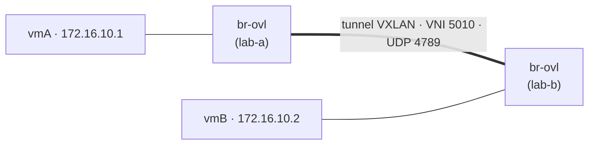

# TP2-B — Overlay VXLAN entre deux hyperviseurs

**Jour 1, 14:45 · 65 min · sur lab-a et lab-b.** Objectif : étendre un segment de niveau 2 entre deux hyperviseurs par un overlay VXLAN. Support : chapitres 5 à 8.

Relier deux « VM » hébergées sur deux hyperviseurs dans un même segment de niveau 2, au-dessus d'un réseau IP. Ici, les deux hyperviseurs sont vos machines lab-a et lab-b, et le réseau IP (l'**underlay**) est le LAN de votre environnement.



**Préparer lab-b.** lab-b est aussi un Ubuntu 24.04 vierge. Installez-y les outils réseau — rapide, sans image ONOS :

```bash
sudo apt-get update && sudo apt-get install -y git
git clone https://github.com/tahero-madi/virtualisation-reseau-sdn.git ~/lab
cd ~/lab
sudo bash infra/preparation_vm.sh --secondaire
```

Relevez l'adresse LAN de chaque machine avec `ip -br a`, et prenez un instantané de lab-a et de lab-b.

### Étape 1 — Sur lab-a (guidé)

```bash
LOCAL=10.10.0.10; REMOTE=10.10.0.11      # adresse LAN de CETTE machine, puis de l'AUTRE (ip -br a)
IF=$(ip -o route get $REMOTE | grep -oP '(?<=dev )\S+'); echo "interface du LAN : $IF"
MOI=vmA; IP=172.16.10.1; AUTRE=172.16.10.2

sudo ovs-vsctl add-br br-ovl
sudo ovs-vsctl add-port br-ovl vx5010 -- set interface vx5010 type=vxlan \
     options:local_ip=$LOCAL options:remote_ip=$REMOTE options:key=5010
sudo ip netns add $MOI
sudo ip link add $MOI-eth0 type veth peer name $MOI-port
sudo ip link set $MOI-eth0 netns $MOI
sudo ovs-vsctl add-port br-ovl $MOI-port && sudo ip link set $MOI-port up
sudo ip -n $MOI addr add $IP/24 dev $MOI-eth0
sudo ip -n $MOI link set $MOI-eth0 up
```

**Ligne par ligne.**

- `LOCAL=… ; REMOTE=…` : l'adresse LAN de cette machine, puis de l'autre (relevées avec `ip -br a`).
- `IF=$(ip -o route get $REMOTE | …)` : trouve automatiquement l'interface du LAN par laquelle on joint l'autre machine, et l'affiche.
- `MOI=vmA; IP=172.16.10.1; AUTRE=172.16.10.2` : le nom de la VM locale, son adresse dans le segment overlay, et l'adresse de la VM d'en face.
- `ovs-vsctl add-br br-ovl` : le commutateur local de l'overlay.
- `add-port br-ovl vx5010 … type=vxlan options:…` : crée le **tunnel VXLAN** vers l'autre machine — `local_ip`/`remote_ip` sont les extrémités (les VTEP), `key=5010` est le **VNI** (l'identifiant du segment).
- les lignes `ip netns add`, `ip link add`, `add-port` : créent la « VM » vmA et la branchent sur le commutateur de l'overlay.
- `ip -n $MOI addr add $IP/24 dev $MOI-eth0` : adresse de la VM dans `172.16.10.0/24`, le segment overlay.

### Étape 2 — Sur lab-b (à vous d'écrire les commandes)

Cette fois, **vous reconstruisez vous-mêmes** le même montage sur lab-b, en repartant du modèle de lab-a. C'est l'intérêt de l'exercice : écrire les commandes, pas les copier. Cible à atteindre sur lab-b :

| Élément | Valeur sur lab-b |
| --- | --- |
| `LOCAL` / `REMOTE` | l'inverse de lab-a : LAN de lab-b, puis LAN de lab-a |
| Nom de la VM (`MOI`) | `vmB` |
| Adresse de la VM (`IP`) | 172.16.10.2 |
| VM d'en face (`AUTRE`) | 172.16.10.1 |
| Commutateur | `br-ovl` |
| Port VXLAN | `vx5010`, VNI `key=5010` |
| Interfaces | `vmB-eth0` (côté VM), `vmB-port` (côté commutateur) |

Adaptez les trois premières lignes de l'étape 1 à ces valeurs, puis rejouez le reste du bloc tel quel (il est déjà écrit avec les variables `$MOI`, `$IP`…).

### Étape 3 — Test et capture

Une fois les deux côtés montés, depuis lab-a :

```bash
sudo ip netns exec $MOI ping -c 3 $AUTRE
sudo tcpdump -n -i $IF -c 4 udp port 4789
sudo tshark -i $IF -f 'udp port 4789' -c 2 -V | grep -A 4 'Virtual eXtensible'
```

**Ligne par ligne.**

- `ip netns exec $MOI ping -c 3 $AUTRE` : vmA pingue vmB ; le trafic passe par le tunnel, alors que lab-a et lab-b ne partagent qu'un réseau IP.
- `tcpdump -n -i $IF -c 4 udp port 4789` : sur le LAN (l'underlay), on voit les paquets VXLAN **encapsulés** — UDP, port 4789.
- `tshark … -V | grep -A 4 'Virtual eXtensible'` : ouvre l'en-tête VXLAN d'un paquet et on y lit le **VNI 5010**.

### Étape 4 — L'expérience MTU

```bash
sudo ip netns exec vmA ping -c 2 -M do -s 1422 172.16.10.2   # 1422 + 28 (IP/ICMP) + 50 (VXLAN) = 1500 : passe tout juste
sudo ip netns exec vmA ping -c 2 -M do -s 1472 172.16.10.2   # 1472 + 28 + 50 = 1550 > 1500 : échoue (-M do interdit de fragmenter)
```

**Ligne par ligne.**

- premier ping : charge utile 1422 octets ; avec 28 d'en-têtes IP/ICMP et 50 de VXLAN, on atteint 1500 — ça passe tout juste.
- second ping : 1472 octets mènent à 1550, au-delà du MTU de 1500 de l'underlay ; `-M do` interdit la fragmentation, donc le paquet est perdu. C'est le symptôme classique « le ping passe, le transfert bloque ».

Questions :

1. Quel est le résultat de chacun des deux pings ? Expliquez par le calcul.
2. Combien de segments VXLAN distincts peut-on créer ? Comparez au VLAN.
3. Ici, qui « sait » où se trouve la machine distante ? Que ferait EVPN ou un contrôleur à la place ?
4. Pourquoi les plugins Kubernetes en mode VXLAN fixent-ils le MTU des pods à 1 450 ?
5. Ajoutez un second segment (VNI 5020) : que faut-il modifier, et qu'est-ce qui garantit l'isolement entre 5010 et 5020 ?

Livrables : `tp2b.sh` et la capture `vxlan.pcap` annotée (VNI, port UDP, en-têtes externe et interne).
