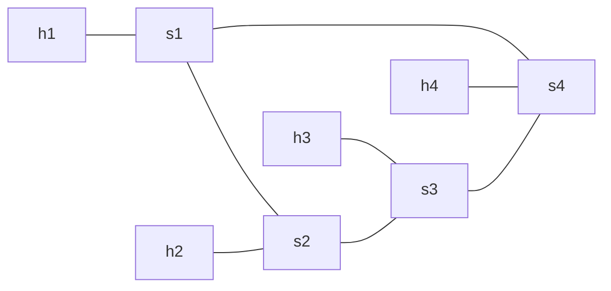

# TP3-A — Prendre en main ONOS

**Jour 2, 09:57 · 45 min.** Objectif : raccorder une topologie Mininet au contrôleur ONOS et l'explorer par l'interface web, la CLI et l'API REST. Support : chapitres 9 à 12. Commencez par `sudo bash reset_lab.sh`.

## Ce qu'on met en place

**Mininet** est un émulateur de réseau : il crée, sur votre seule VM, de vrais switches Open vSwitch et de vrais hôtes (des namespaces), reliés par des câbles virtuels. On peut donc jouer une topologie complète sans aucun matériel. On lui dit soit une topologie toute faite (`--topo single,3`), soit une topologie décrite dans un fichier Python.

**`ring.py`** est justement ce fichier. Il décrit un anneau de 4 switches, un hôte par switch :

```python
class RingTopo(Topo):
    def build(self, n=4):
        switches = [self.addSwitch(f"s{i}") for i in range(1, n + 1)]
        for i, sw in enumerate(switches, start=1):
            self.addLink(self.addHost(f"h{i}"), sw)   # un hôte h<i> raccordé à chaque switch s<i>
        for i in range(n):
            self.addLink(switches[i], switches[(i + 1) % n])   # relie s<i> à son voisin : l'anneau
topos = {"ring": RingTopo}
```

- `addSwitch(f"s{i}")` : crée les switches s1 à s4.
- la première boucle : crée un hôte h1…h4 et le relie à son switch.
- la seconde boucle : relie chaque switch au suivant, le dernier revenant au premier — d'où l'**anneau**.
- `topos = {"ring": RingTopo}` : expose la topologie sous le nom `ring`, utilisable avec `--topo ring`.

On choisit un anneau parce qu'il offre **deux chemins** entre chaque paire de switches : c'est ce qui permettra, au TP3-B, de couper un lien et de voir ONOS recalculer.



### Étape 1 — Lancer ONOS puis la topologie

```bash
sudo bash reset_lab.sh
sudo docker run -d --name onos -p 8181:8181 -p 8101:8101 -p 6653:6653 \
  -e ONOS_APPS=drivers,openflow,proxyarp,fwd,gui2 onosproject/onos:2.7.0
until curl -sf -u onos:rocks http://localhost:8181/onos/v1/applications > /dev/null; do sleep 5; done
echo "ONOS prêt"

sudo mn --custom ring.py --topo ring --mac \
        --switch ovs,protocols=OpenFlow13 \
        --controller remote,ip=127.0.0.1,port=6653
mininet> pingall
```

**Ligne par ligne.**

- `reset_lab.sh` : repart d'une machine propre (namespaces, bridges, Mininet, ONOS d'un essai précédent).
- `docker run … onosproject/onos:2.7.0` : lance ONOS dans un conteneur, en publiant ses trois ports — **8181** (interface web), **8101** (CLI en SSH), **6653** (canal OpenFlow vers les switches). `ONOS_APPS=…` active d'emblée les applications dont on a besoin.
- `until curl … ; do sleep 5; done` : attend qu'ONOS réponde ; il met une à deux minutes à démarrer.
- `mn --custom ring.py --topo ring` : lance Mininet avec la topologie en anneau définie dans `ring.py`.
- `--mac` : donne aux hôtes des adresses MAC lisibles (`…:01` pour h1, etc.).
- `--switch ovs,protocols=OpenFlow13` : des switches Open vSwitch parlant OpenFlow 1.3.
- `--controller remote,ip=127.0.0.1,port=6653` : les switches sont pilotés par ONOS (contrôleur distant).
- `pingall` : teste la connectivité entre tous les hôtes ; s'il y a des pertes au premier passage, relancez-le une fois, le temps que l'application `fwd` apprenne les hôtes.

### Étape 2 — Prendre en main l'interface web d'ONOS

Dans le Firefox de lab-a, ouvrez `http://localhost:8181/onos/ui` (identifiants **onos / rocks**). Le minimum à connaître :

- **La vue Topology** (icône en haut à gauche, ou touche `T`) : affiche switches, liens et hôtes. Touche **`H`** pour afficher/masquer les hôtes, **`L`** pour les étiquettes, **`P`** pour le panneau de détails. Cliquez un switch pour voir ses ports et ses flux.
- **Le menu** (les trois traits en haut à gauche) donne accès aux vues **Applications**, **Devices**, **Links**, **Hosts**, **Flows**… la même information que la CLI, en graphique.
- **Les applications par défaut** (vue Applications) : ce sont les briques activées plus haut par `ONOS_APPS`. Les connaître aide à comprendre ce qui se passe :
  - `org.onosproject.openflow` (**openflow**) : parle OpenFlow aux switches (le pilote sud).
  - `org.onosproject.fwd` (**fwd**, *Reactive Forwarding*) : l'acheminement automatique et réactif — c'est lui qui pose des règles au `pingall`. On le **désactivera** au TP3-B.
  - `org.onosproject.proxyarp` (**proxyarp**) : répond aux requêtes ARP à la place des hôtes, grâce à la vue globale.
  - `org.onosproject.drivers` : les pilotes d'équipements ; `gui2` : l'interface web elle-même.

### Étape 3 — Explorer par la CLI et l'API

```bash
ssh -p 8101 onos@localhost      # mot de passe : rocks
```

Dans la CLI ONOS : `apps -a -s` (applications actives), `devices`, `links`, `hosts`, `flows -s`.

Par l'API REST (interface nord) :

```bash
API=http://localhost:8181/onos/v1; AUTH=onos:rocks
curl -s -u $AUTH $API/devices | jq -r '.devices[].id'
curl -s -u $AUTH $API/links   | jq '.links | length'
curl -s -u $AUTH $API/hosts   | jq -c '.hosts[] | {mac, ipAddresses}'
```

**Ligne par ligne.**

- `ssh -p 8101 onos@localhost` : ouvre la ligne de commande d'ONOS (Apache Karaf), sur le port 8101.
- `apps -a -s` : liste les applications **a**ctives, format court (**s**).
- `devices` / `links` / `hosts` / `flows -s` : les switches, les liens, les hôtes, les flux installés.
- côté API : `/devices` liste les switches vus par ONOS, `/links | length` compte les liens découverts, `/hosts` donne les hôtes appris (MAC et IP). `jq` met la réponse JSON en forme.

Questions :

1. ONOS compte 8 liens pour 4 câbles entre switches : pourquoi ?
2. Comment ONOS découvre-t-il les liens ? (indice : LLDP, PACKET\_OUT, PACKET\_IN)
3. Comparez la table de flux de s1 avant et après `pingall` : quelle application a posé les règles ?
