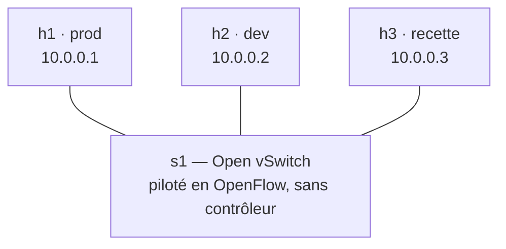

# TP4-A — Programmer un switch à la main

**Jour 2, 13:50 · 45 min.** Objectif : programmer la politique d'un switch règle par règle, en OpenFlow, sans contrôleur. Support : chapitres 14 à 17.

## En quoi ce TP diffère du module 3

Ce matin (TP3), un **contrôleur** ONOS posait les règles pour nous : on lui décrivait une intention, il calculait et programmait les switches. Cet après-midi, **on retire le contrôleur**. On recrée un petit réseau sous Mininet — un switch Open vSwitch `s1` et trois hôtes h1/h2/h3 — mais cette fois **c'est vous** qui écrivez les règles OpenFlow, directement dans le switch, avec `ovs-ofctl`. Même protocole (OpenFlow), mais sans l'intermédiaire du contrôleur : on voit ce qu'il faisait à notre place.

Correspondance : h1 serveur prod (10.0.0.1), h2 poste dev (10.0.0.2), h3 poste recette (10.0.0.3).



### Étape 0 — Un switch sans contrôleur

```bash
sudo docker stop onos; sudo mn -c
sudo mn --topo single,3 --mac --switch ovs,protocols=OpenFlow13 --controller none
mininet> pingall
```

**Ligne par ligne.**

- `docker stop onos; mn -c` : arrête ONOS (libère le port 6653) et nettoie Mininet d'une session précédente.
- `mn --topo single,3 … --controller none` : un seul switch, trois hôtes, en OpenFlow 1.3, **sans contrôleur**.
- `pingall` : échoue (100 % de pertes) — le switch Mininet démarre en mode `secure`, donc sans règle il ne livre rien.

### Étape 1 — Connectivité de base

Dans un second terminal :

```bash
OF="sudo ovs-ofctl -O OpenFlow13"
sudo ovs-vsctl get-fail-mode s1              # "secure" : sans contrôleur, le switch ne fait rien

$OF add-flow s1 "priority=100,arp,actions=flood"
$OF add-flow s1 "priority=100,ip,nw_dst=10.0.0.1,actions=output:1"
$OF add-flow s1 "priority=100,ip,nw_dst=10.0.0.2,actions=output:2"
$OF add-flow s1 "priority=100,ip,nw_dst=10.0.0.3,actions=output:3"
$OF dump-flows s1
```

**Ligne par ligne.**

- `OF="sudo ovs-ofctl -O OpenFlow13"` : raccourci pour parler au switch en OpenFlow 1.3, sans répéter l'option `-O`.
- `ovs-vsctl get-fail-mode s1` : confirme le mode `secure` — le switch privé de contrôleur ne commute rien par lui-même.
- `add-flow … priority=100,arp,actions=flood` : l'ARP est diffusé sur tous les ports.
- les trois `add-flow … ip,nw_dst=…,actions=output:N` : ce qui va vers h1 sort au port 1, vers h2 au port 2, vers h3 au port 3.
- `dump-flows s1` : affiche les règles posées **et leurs compteurs** (paquets, octets) — votre premier outil de diagnostic.

### Étape 2 — La politique de sécurité

```bash
$OF add-flow s1 "priority=200,icmp,nw_src=10.0.0.3,nw_dst=10.0.0.1,actions=drop"
$OF add-flow s1 "priority=300,tcp,nw_src=10.0.0.2,nw_dst=10.0.0.3,tp_dst=80,actions=output:3"
$OF add-flow s1 "priority=250,ip,nw_src=10.0.0.2,nw_dst=10.0.0.3,actions=drop"
```

**Ligne par ligne.**

- `priority=200,icmp,nw_src=10.0.0.3,nw_dst=10.0.0.1,actions=drop` : jette le ping recette → prod (`drop` = liste d'actions vide).
- `priority=300,tcp,…,tp_dst=80,actions=output:3` : dev → recette en HTTP (port 80) autorisé ; priorité la plus haute, donc elle l'emporte.
- `priority=250,ip,nw_src=10.0.0.2,nw_dst=10.0.0.3,actions=drop` : dev → recette, **tout le reste** jeté.

Tester, côté Mininet :

```text
mininet> h3 ping -c 2 h1                                                      # recette -> prod : bloqué
mininet> h2 ping -c 2 h1                                                      # dev -> prod : passe (aucune règle ne le bloque)
mininet> h3 python3 -m http.server 80 &                                      # serveur web sur h3
mininet> h2 curl -s -m 3 -o /dev/null -w "%{http_code}\n" http://10.0.0.3/   # dev -> recette en HTTP : 200
mininet> h2 ping -c 2 h3                                                      # dev -> recette hors HTTP : bloqué
mininet> h1 ping -c 2 h3                                                      # prod -> recette : voir question 2
```

- chaque ligne teste un cas de la politique ; notez le résultat. Le dernier (`h1 ping h3`) révèle un piège étudié en question 2.

### Étape 3 — Expliquer un comportement

```bash
sudo ovs-appctl ofproto/trace s1 in_port=3,icmp,nw_src=10.0.0.3,nw_dst=10.0.0.1
```

- `ofproto/trace` **simule** le parcours d'un paquet (ici un ping de h3 vers h1 entrant au port 3) et affiche, table par table, la règle retenue avec sa priorité, puis l'action finale. C'est l'outil qui répond à « pourquoi ce paquet ne passe-t-il pas ? ».

### Étape 4 (bonus) — Copier le trafic vers une sonde

```bash
$OF add-group s1 group_id=1,type=all,bucket=output:1,bucket=output:3
$OF --strict mod-flows s1 "priority=100,ip,nw_dst=10.0.0.1,actions=group:1"
$OF dump-ports s1 3
```

**Ligne par ligne.**

- `add-group … type=all,bucket=output:1,bucket=output:3` : un groupe « all » qui duplique chaque paquet vers le port 1 **et** le port 3.
- `--strict mod-flows … nw_dst=10.0.0.1,actions=group:1` : ce qui va vers h1 passe désormais par ce groupe (donc est aussi copié vers h3).
- `dump-ports s1 3` : les compteurs du port 3 montent — il reçoit bien la copie.

Questions :

1. Pourquoi `pingall` échoue-t-il au départ ? Que répond `get-fail-mode` ?
2. Notez le résultat de chaque test de l'étape 2. Pourquoi h1 ne peut-il plus pinguer h3, alors que seule la recette vers la prod est interdite ? Corrigez avec `icmp_type=8`.
3. Que lit-on dans la sortie de `ofproto/trace` ?
4. Comment rejouer toute la configuration d'un coup ? (indice : `add-flows` et `replace-flows` lisent un fichier)

Livrable : `regles_tp4a.txt` rejouable par `replace-flows`, commité.
